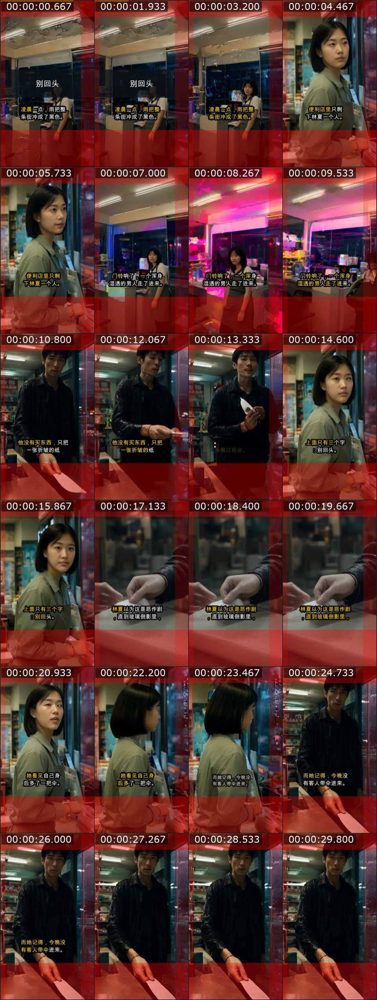

# Local AI Video Pipeline

A compact, reproducible subset of a local-first AI short-drama pipeline built around ComfyUI, Qwen-Image, Wan2.2, OpenCV, and FFmpeg.

The repository focuses on the engineering around generative video rather than model weights: serial ComfyUI submission, strict shot validation, resumable manifests, bounded long-running jobs, automatic motion checks, and human review gates.



## Why this repository exists

Generating a video successfully is not the same as producing a usable shot. This pipeline treats them as separate problems:

1. Validate the requested Wan2.2 profile before submission.
2. Submit one ComfyUI job at a time and record a resumable manifest.
3. Run long jobs in the background with a lock and bounded status checks.
4. Measure motion, frozen frames, black frames, and decode integrity.
5. Require a separate visual review for faces, anatomy, props, and continuity.

## Measured results

The source workflow was exercised on an Apple M4 with 16 GB unified memory. These are local measurements, not universal performance claims.

| Wan2.2 profile | Output length | Steps | Measured time | Outcome |
|---|---:|---:|---:|---|
| 512x768 / 81 frames | 3.375 s | 20 | 2041.3 s | Quality baseline; human review WARN |
| 512x768 / 81 frames | 3.375 s | 4 | 420.4 s | 4.86x faster; preview quality |
| 384x576 / 61 frames | 2.542 s | 4 | 165.2 s | Fastest tested preview profile |
| 416x608 / 73 frames | 3.042 s | 4 | 240.3 s | Speed/composition compromise; preview only |

An end-to-end validation short was also assembled at 1080x1920, 30 fps, 31 seconds, with AAC audio, -14 LUFS normalization, and subtitle-safe placement. The source project reported zero TikTok format-check failures and zero warnings for that delivery profile.

See [docs/benchmarks.md](docs/benchmarks.md) for the measurement details and caveats.

## What is included

- `scripts/wan22_shots.py` - validates shot profiles, builds a ComfyUI API graph, submits jobs serially, waits with deadlines, and supports resume.
- `scripts/evaluate_wan22_action.py` - checks motion, freeze ratio, black ratio, first/last-frame difference, and decode integrity with OpenCV and ffprobe.
- `scripts/run_job_background.sh` - starts one exclusive long-running job and records PID, exit code, and logs.
- `scripts/check_job.sh` - returns a bounded status snapshot without tailing indefinitely.
- `scripts/session_budget.py` - reports multimodal agent-session payload growth before it reaches upstream limits.
- `scripts/make_contact_sheet.sh` - creates one compact review sheet after applying the session-budget gate.
- `tests/` - focused tests for graph construction, profile validation, job resumption inputs, and video metrics.
- `examples/shots.example.json` - a minimal preview request that can be inspected with `--dry-run`.

## Requirements

- Python 3.10+
- NumPy
- OpenCV Python
- FFmpeg and ffprobe on `PATH`, or explicit `FFMPEG_BIN` / `FFPROBE_BIN` environment variables
- A reachable ComfyUI instance
- The model files and custom nodes referenced by your own graph

Model weights and generated media are intentionally not included.

```bash
python3 -m venv .venv
source .venv/bin/activate
pip install -r requirements-dev.txt
```

## Quick start

Place a start frame named `example_start.png` in a local input directory, then validate the example without submitting anything:

```bash
python3 scripts/wan22_shots.py \
  --shots examples/shots.example.json \
  --input-dir /path/to/input \
  --output-dir /path/to/output \
  --runs-dir /path/to/runs \
  --dry-run
```

Run a real job in the background:

```bash
bash scripts/run_job_background.sh wan22-preview -- \
  python3 scripts/wan22_shots.py \
  --shots examples/shots.example.json \
  --input-dir /path/to/input \
  --output-dir /path/to/output \
  --runs-dir /path/to/runs
```

Check it once rather than tailing logs:

```bash
bash scripts/check_job.sh wan22-preview
```

Evaluate the output:

```bash
python3 scripts/evaluate_wan22_action.py /path/to/output/example_preview.mp4 \
  --json-out /path/to/runs/example_preview.eval.json
```

## Important limitations

- This is an experimental engineering showcase, not a one-click installer.
- The ComfyUI graph includes project-specific custom node names for optional first/last-frame and camera conditioning paths.
- Automatic PASS means the file decodes and contains measurable motion. It does not prove that the face, hands, props, or story are usable.
- Preview resolutions are not a substitute for a production master.
- Third-party model and LoRA licenses remain the user's responsibility.

## Roadmap

- Validate the same ComfyUI API workload on ROCm with AMD Instinct GPUs.
- Separate pure Wan2.2 graph construction from optional project-specific custom nodes.
- Add checkpointable benchmark manifests and machine-readable environment capture.
- Expand evaluators for identity drift, prop continuity, and subtitle safe areas.
